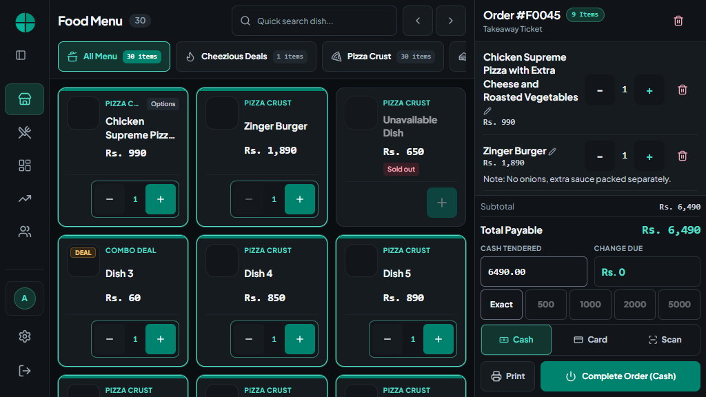
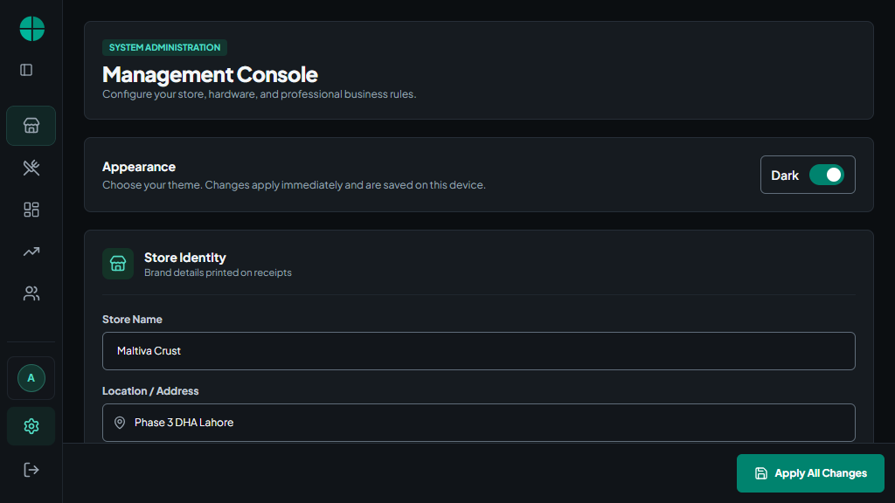
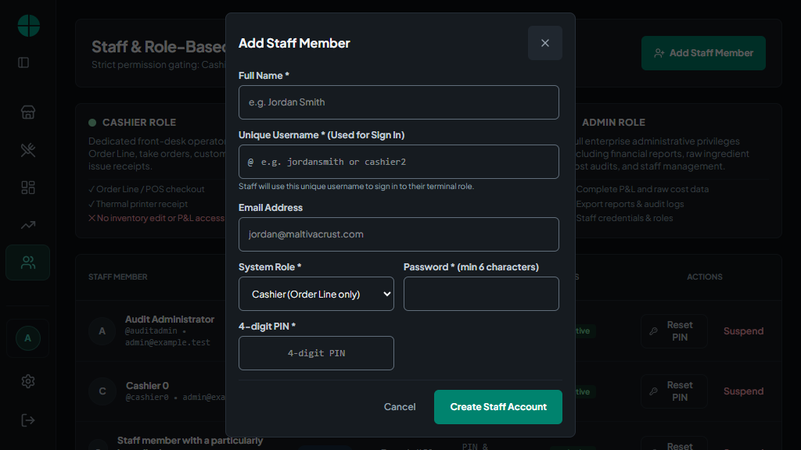
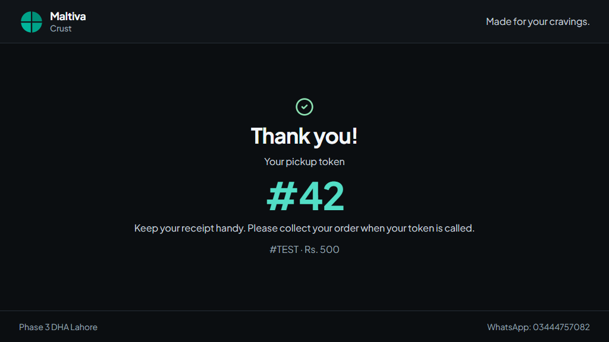

# Touch layout re-verification

Date: 2026-10-30. Target: a landscape 720p touch POS terminal.

## Verdict

The revised interface is substantially better suited to 1280 x 720 and approximately 1024 x 576 CSS pixels (the latter represents a fullscreen 1280 x 720 monitor at 125% scaling). The deeper audit found additional defects beyond the original checkout changes; the confirmed defects below were corrected.

No layout blockers or automated accessibility violations remained in the **172 primary page/dialog snapshots** after the fixes. This is evidence for the tested states, not a claim that every possible business state, browser, operating-system keyboard, or accessibility requirement is certified.

## Method and coverage

- Headless Chrome with touch enabled, using the actual React App and its components, original HTML head, and loaded Plus Jakarta Sans fonts.
- Isolated, fictional fixtures and mocked API methods. No live staff, sales, inventory, or production database records were modified by the browser audit.
- Both dark and light themes at 1280 x 720 and 1024 x 576: 43 states per combination, 172 snapshots total.
- Checks per primary snapshot: document overflow, control clipping by non-scrolling ancestors, 44px touch targets for buttons/text inputs/selects, dialog action bounds, runtime errors, and axe rules tagged WCAG A/AA and WCAG 2.1 AA. Checkbox/radio hit areas are provided by their wrapping labels.
- **32 supplementary layout snapshots** at 800 x 600 and 375 x 667, including mobile navigation, checkout, dialogs, and scrolling login.
- **44 additional assertions** at 1280 x 720, 1024 x 576, 1366 x 768, and approximately 1093 x 614: all payment methods, empty cart, expanded navigation, manager/cashier navigation, persistent Settings save, authentication notices, many rejected sales, and checkout locking.
- Finite transitions and font loading were allowed to settle before contrast measurements, avoiding false contrast reports from interpolated transition frames.
- Source review included all components under `src/components`, the app shell, shared dialog behavior, themes, and print layout rules. The customer directory, tables, and Help components are dormant: they are not routed by the current App/navigation, so they were inspected separately with populated fixtures where appropriate.

## Page and section coverage

| Surface | Reviewed states and sections | Result |
| --- | --- | --- |
| Login | Staff selection/overflow, long names, PIN keypad, password mode, show/hide password, validation errors, pending/offline notice, authentication in progress | Pass; login intentionally keeps dark branding independently of the POS theme |
| Navigation | Collapsed/expanded desktop rail, scrolling mobile drawer, admin/manager/cashier destinations, logout confirmation | Pass |
| Order Line | Search, category strip/arrows, product names/images/prices, selected quantity controls, unavailable/sold-out badges, scrolling product grid, empty cart | Pass; four columns at 1280px and three at 1024px with the collapsed rail |
| Cart and payment | Simple/long names, notes, removal/editing/quantity, cash/card/scan, quick amounts, touch keypad, decimal change, checkout lock, clear-order confirmation | Pass; line count depends on actual names/options/notes |
| Sale notifications | Many rejected orders, bounded scrolling warnings, retry/review controls, login pending notice | Pass; checkout remains in the viewport |
| Dishes & Deals | Category selection/actions, grid and list source paths, action menu, dish/deal editors, variation groups/options, long native select options, custom bundle items | Pass |
| Category/stock/delete dialogs | Category name/icon grid, stock type/quantity/reason, deletion confirmation, fixed form actions | Pass |
| Daily Sales | Period/payment filters, custom dates and errors, summary sections, order register, reprint entry point | Pass; long tables retain horizontal scrolling |
| Profit & Loss | Period/category/payment filters, custom dates, totals, breakdown table, print/export entry points | Pass; table has keyboard scrolling support |
| Staff | Role descriptions, populated staff table, add account, reset PIN/password, pending submission, labels/focus/escape | Pass |
| Settings | Appearance, identity/contact/tax, hardware/paper width, customer display controls, operations/low-stock, maintenance/cache confirmation, persistent save/error feedback | Pass |
| Receipt | Customer/kitchen/both slips, 58mm/80mm, scrolling receipt body, copy/done/print controls | Pass; physical printer output still requires hardware testing |
| Customer display | Welcome, populated cart, confirmed token, pending, rejected, draft | Pass; short-screen confirmation fits |
| Dormant components | Customer cards/search, table cards/status filters/actions, Help content | Layout reviewed; these are not active product routes |

## Confirmed defects corrected

| Priority | Finding | Change |
| --- | --- | --- |
| P1 | Fourteen rejected-sale notices placed checkout around y=1430 on a 576px screen. | Notices now live in a bounded scrolling region; checkout remains inside the viewport. |
| P1 | Clearing a dish price caused the live profit preview to throw during rendering. | Incomplete price input renders a neutral prompt; Save still rejects invalid precision. Regression tested. |
| P1 | Staff forms had unbounded custom overlays and lacked the shared modal's focus/escape/background handling. | Both staff dialogs now use the shared Dialog, bounded scrolling fields, fixed actions, and submission locking. |
| P1 | Customer confirmation details were clipped behind the footer on short landscape displays. | Short-screen spacing/type were adjusted and main content has a scroll fallback. |
| P1 | The logo inherited light-theme text on the dark login background. | Authentication has scoped dark text/focus tokens, including pending notices. |
| P2 | Small buttons/inputs remained across reports, menus, staff, settings, variation options, receipts, and confirmations. | Touch-capable devices receive minimum 44px controls; checkbox/radio labels provide larger hit areas. |
| P2 | Settings save scrolled away from the edited sections. | Save and save errors now remain in a bottom dock. |
| P2 | Missing associations/names affected Settings, staff fields, custom dates, category filtering, and password visibility. | Added explicit labels, accessible names, and selection states. |
| P2 | Keyboard users could not reliably scroll the receipt/profit table; hidden dialog controls could interfere with focus wrapping. | Scroll regions are focusable and named; focus trapping ignores controls hidden by CSS ancestors. Regression tested. |
| P2 | Long deal select options could push controls beyond their column; bundle controls crowded long names. | Native inputs/selects can shrink within editor columns, and bundle rows wrap. |
| P2 | Login controls stayed editable while authentication was pending. | Profile/auth fields and PIN keyboard handling are locked until the result. Regression tested. |
| P2 | Managers saw a P&L navigation destination that already rendered an access-denied page. | The navigation now matches the existing admin-only UI. This does not change server permission policy. |

The earlier cart breakpoint, cash keypad/quick tender, two-column login, and once-per-tap quantity fixes were reverified as part of this pass.

## Validation

- Session-only commit snapshot, checked in an isolated temporary directory: **152 tests across 25 files**, TypeScript, and production build passed. This snapshot excludes the concurrent authentication/server changes.
- TypeScript: passed.
- Unit/integration tests: **179 passed across 26 files** (final integration run, including concurrent authentication/server edits).
- Production build: passed.
- Electron configuration checks: passed.
- Primary browser matrix: **172/172 snapshots without detected overflow, clipping, undersized non-checkbox controls, automated accessibility violations, or JavaScript runtime errors**.
- Narrow-screen layout snapshots: **32 completed** without detected document/dialog horizontal overflow or out-of-viewport dialogs.
- Supplemental state assertions: **44 passed**.
- Four additional login checks after concurrent authentication edits: both themes at both primary sizes passed, using the new pre-authentication staff API shape.
- Detailed machine-readable observations: [verification.json](verification.json).

Build output: approximately 472 kB JavaScript (127 kB gzip), 55 kB CSS (11 kB gzip), and a 963 kB customer-display photo. These are bundle measurements, not a low-end terminal performance benchmark.

## Concurrent workspace changes

Authentication and server files changed independently during this audit. Those edits were preserved. The 172-state matrix records the layout audit; the changed login was subsequently rechecked in four focused browser cases, and TypeScript, all 179 tests, and the production build were rerun against the integrated workspace. Server policy changes were not authored as part of this layout pass.

## Remaining limits and follow-ups

1. Test finger accuracy, viewing distance, Windows scaling, touch-keyboard behavior, receipt printing, and scrolling on the actual monitor. CSS emulation cannot establish physical comfort or device-driver behavior.
2. Large reports intentionally scroll, including horizontally where needed. Long product labels are clamped on menu cards; the cart/customizer shows complete names. Density must not be judged using a promised fixed number of visible items.
3. Customer directory/table/Help components are not active routes. The dormant New Customer button has no handler, and Help contains outdated workflow descriptions. Complete or remove those surfaces before exposing them through navigation.
4. Optional performance follow-up: optimize the large welcome photo and consider self-hosting fonts for reliable first launch without internet. Performance on the actual terminal was not profiled here.
5. This pass is a UI/layout and interaction audit. It is not a full audit of backend authorization, every recovery/storage failure, or native printer integration.

## Representative 1024 x 576 screenshots

All screenshots use fictional audit data.

### Order Line and persistent checkout

### Settings with persistent save

### Staff dialog with reachable actions

### Customer confirmation

